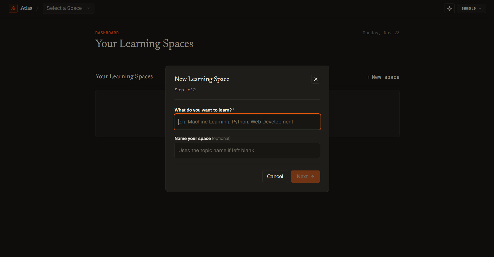
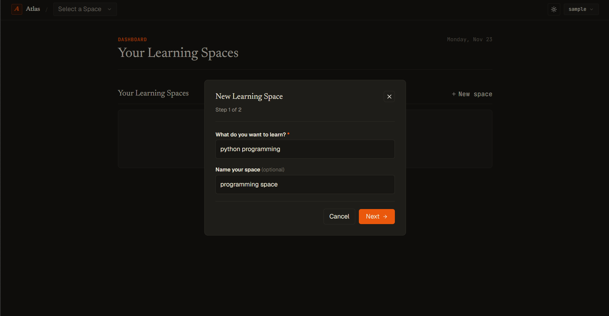
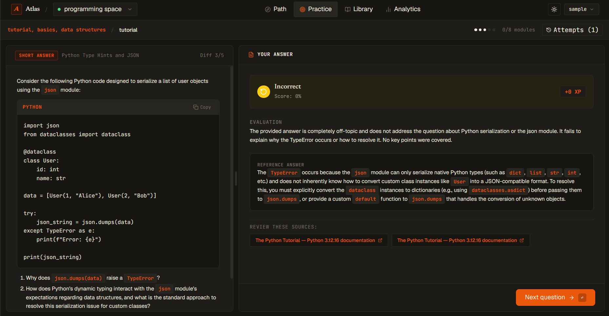

### Navigation

- <a href="#atlas-learning-that-understands-you">About Atlas</a> - Introduction and the problem Atlas addresses.
- <a href="#our-solution">Our Solution</a> - What Atlas does and how it helps learners.
- <a href="#how-it-works">How It Works</a> - Step-by-step learning workflow.
- <a href="#key-features">Key Features</a> - Main capabilities of the platform.
- <a href="#technology-stack">Technology Stack</a> - Technologies and tools used to build Atlas.
- <a href="#future-development">Future Development</a> - Planned improvements and upcoming features.
- <a href="#our-vision">Our Vision</a> - The long-term goal of Atlas.
- <a href="#prototype-images">Prototype Images</a> - Screenshots showcasing the working prototype.

---

# ATLAS : Learning That Understands You

What if a learning platform could understand what you already know, identify your knowledge gaps, and guide you on what to learn next?

Most learning platforms provide predefined courses and fixed learning paths. But every learner has different goals, experience, and learning speed.

The problem is not the lack of learning resources. It is finding the right learning path for each individual.

## Our Solution

Atlas is an adaptive learning platform that creates personalized learning journeys based on a learner's existing knowledge, goals, and performance.

Instead of following the same roadmap, learners receive relevant resources, personalized assessments, and learning activities that adapt as they progress.

## How It Works

1. **Understand the Learner** : Identify existing knowledge, goals, and available study time.
2. **Build a Roadmap** : Generate structured learning paths with modules, prerequisites, and objectives.
3. **Discover Resources** : Find relevant materials from websites, documentation, YouTube, and academic sources.
4. **Practice and Assess** : Generate questions, problems, and coding challenges.
5. **Track Understanding** : Measure concept-level mastery, identify weaknesses, and adjust difficulty.
6. **Adapt Continuously** : Update upcoming learning activities based on learner performance.

## Key Features

- Knowledge-aware personalized roadmaps.
- Adaptive assessments and difficulty levels.
- Learning resource discovery from multiple sources.
- Concept-level progress and mastery tracking.
- RAG-based learning assistance.
- Support for multiple subjects and disciplines.

## Technology Stack

| Component | Technologies |
|---|---|
| Frontend | React 18, TypeScript, Vite, Tailwind CSS |
| UI & Navigation | React Router, Axios, Markdown Rendering, Prism.js |
| Backend | Python 3.12+, FastAPI, REST APIs |
| AI & LLM Integration | Groq API, LLM-based Processing, Prompt Engineering |
| AI Orchestration | Modular AI Pipelines, Context-Aware Generation |
| Knowledge Retrieval | Retrieval-Augmented Generation (RAG), Qdrant, Vector Search |
| Embeddings | Text Embeddings, Semantic Search, Document Chunking |
| Resource Discovery | DuckDuckGo Search, YouTube, arXiv, OpenAlex |
| Document Processing | PDF Extraction, Document Parsing, Web Content Extraction |
| Learning Engine | Adaptive Assessment, Dynamic Question Generation, Mastery Tracking |
| Roadmap Engine | Personalized Roadmap Generation, Prerequisite Mapping, Learning Objectives |
| Code Evaluation | Python Code Execution, Test-Case Evaluation, LLM-Based Assessment |
| Data Storage | SQLite, JSON Persistence, File System Storage |
| Authentication | JWT Access & Refresh Tokens, bcrypt Password Hashing |
| API Communication | RESTful Architecture, Axios, JSON |
| Background Processing | APScheduler, Parallel Resource Discovery |
| Testing | Pytest, Automated API Testing |
| Development & Deployment | Git, GitHub, Uvicorn, Environment-Based Configuration |

## Future Development

Our next phase focuses on making Atlas more intelligent and reliable through:

- Personal Knowledge Graph and Learning Digital Twin.
- Intelligent revision and knowledge-retention tracking.
- Autonomous research and evidence-based verification.
- Real-world projects and AI viva simulations.
- Docker, Kubernetes, and AWS deployment.
- Improved model selection, retrieval, security, and scalability.

## Our Vision

We want to build a learning system where progress is measured by understanding rather than course completion.

Atlas aims to make learning more personal, adaptive, and goal-oriented.

## Prototype Images

### 1. User Registration
Multiple users can register and access their accounts.

### 2. Multiple Learning Spaces
Each user can create multiple spaces, each with its own learning path.

### 3. Choose What to Learn
Enter any subject, skill, or topic you want to learn.

### 4. Set Your Learning Target
Skip concepts you already know and define your learning goals.

### 5. Personalized Roadmap
Get a structured roadmap with relevant learning resources.

### 6. Resource Tracking
View recommended resources and track their status.

### 7. Module Progress
View current modules, learning objectives, and progress.

### 8. Dynamic Question Generation
AI generates questions based on your knowledge, goals, and previous answers.

### 9. Detailed Answer Explanations
Understand incorrect answers through clear explanations.

### 10. Adaptive Learning
Question difficulty and upcoming activities adapt to your performance.

**Atlas — A smarter way to understand how you learn.**
