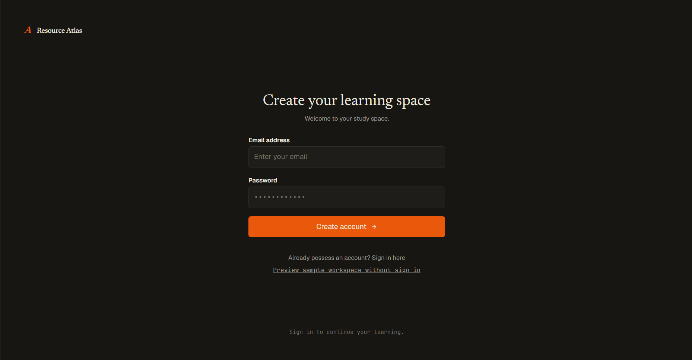
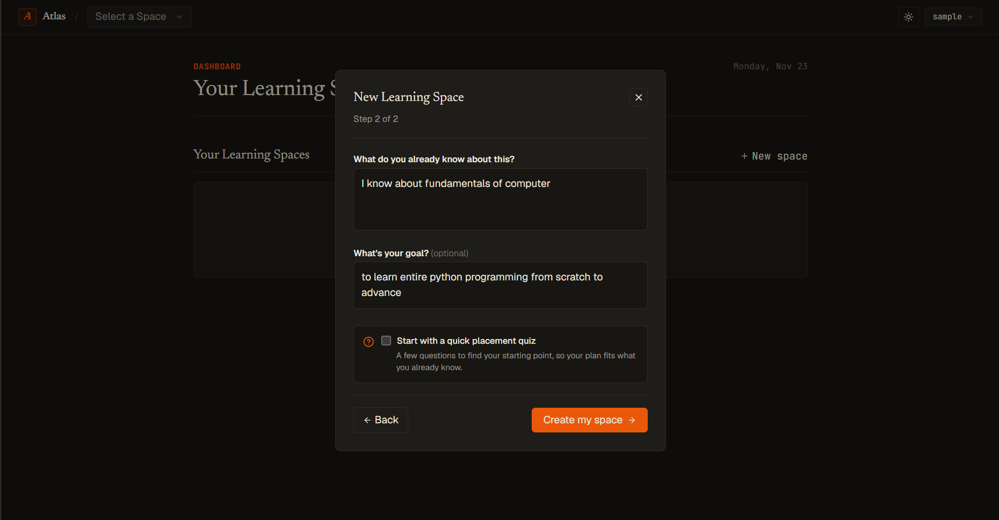
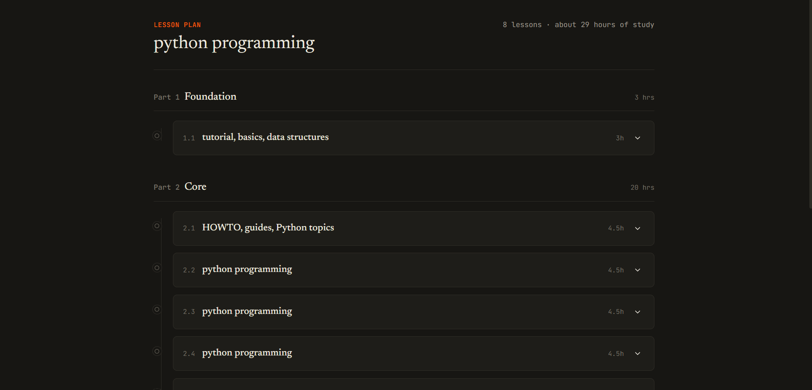
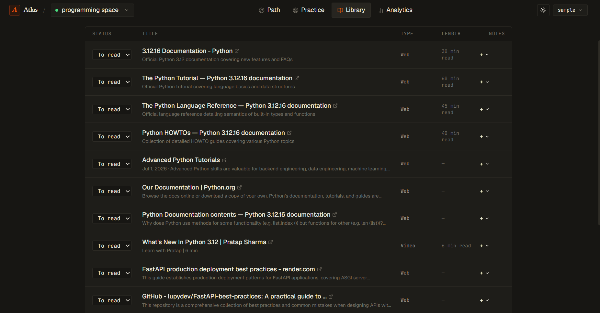
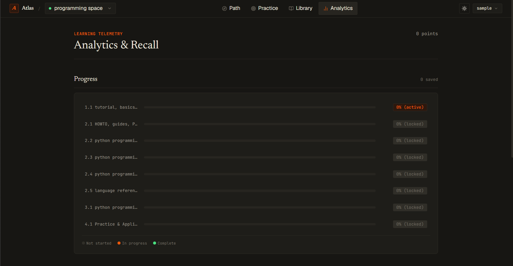
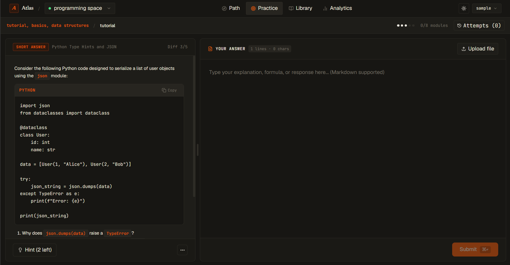
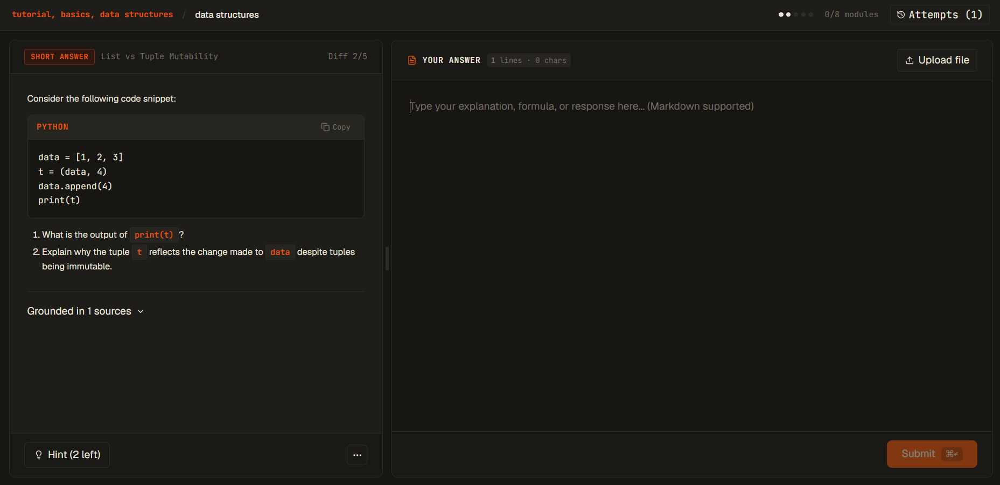

# ATLAS — Learning That Understands You

What if a learning platform could understand what you already know, identify your knowledge gaps, and guide you on what to learn next?

Most learning platforms provide predefined courses and fixed learning paths. But every learner has different goals, experience, and learning speed.

The problem is not the lack of learning resources. It is finding the right learning path for each individual.

## Our Solution

Atlas is an adaptive learning platform that creates personalized learning journeys based on a learner's existing knowledge, goals, and performance.

Instead of following the same roadmap, learners receive relevant resources, personalized assessments, and learning activities that adapt as they progress.

## How It Works

1. **Understand the Learner** — Identify existing knowledge, goals, and available study time.
2. **Build a Roadmap** — Generate structured learning paths with modules, prerequisites, and objectives.
3. **Discover Resources** — Find relevant materials from websites, documentation, YouTube, and academic sources.
4. **Practice and Assess** — Generate questions, problems, and coding challenges.
5. **Track Understanding** — Measure concept-level mastery, identify weaknesses, and adjust difficulty.
6. **Adapt Continuously** — Update upcoming learning activities based on learner performance.

## Key Features

- Knowledge-aware personalized roadmaps.
- Adaptive assessments and difficulty levels.
- Learning resource discovery from multiple sources.
- Concept-level progress and mastery tracking.
- RAG-based learning assistance.
- Support for multiple subjects and disciplines.

## Technology Stack

| Component | Technologies |
|---|---|
| Frontend | React, TypeScript, Vite, Tailwind CSS |
| Backend | Python, FastAPI |
| AI | Groq LLM APIs |
| Retrieval | RAG, Qdrant, Embeddings |
| Resource Discovery | Web Search, YouTube, arXiv, OpenAlex |
| Storage | SQLite, JSON, File Storage |
| Security | JWT, bcrypt |

## Future Development

Our next phase focuses on making Atlas more intelligent and reliable through:

- Personal Knowledge Graph and Learning Digital Twin.
- Intelligent revision and knowledge-retention tracking.
- Autonomous research and evidence-based verification.
- Real-world projects and AI viva simulations.
- Docker, Kubernetes, and AWS deployment.
- Improved model selection, retrieval, security, and scalability.

## Our Vision

We want to build a learning system where progress is measured by understanding rather than course completion.

Atlas aims to make learning more personal, adaptive, and goal-oriented.

## Prototype Images

Multiple users can register

A user have multiple space - each space have it's own learing path

A user can enter anything that he/she want to learn

Ignore what you already learnt and set your target

Personalized roadmap and beloning resources

Every resource and it's status

Current modules information and tracking

AI creates dynamic questions based on your knowledge, goals and previous answers

Gives proper explaination of wrong answers

Adaptive learning and question making by AI

**Atlas — A smarter way to understand how you learn.**
